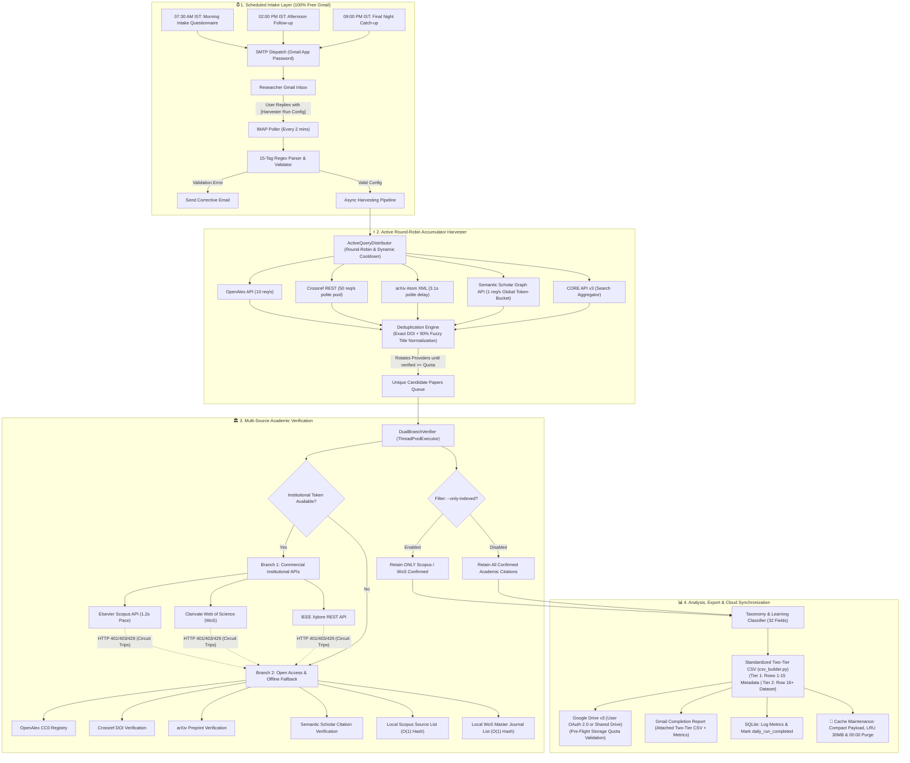

# 📘 Complete Handbook & Master Engineering Manual

## Unified Academic Paper Harvester, Verifier & 100% Gmail-Driven Pipeline 🎓

Welcome to the definitive engineering manual and user handbook for the **Unified Academic Paper Harvester & Verifier**. This manual provides an exhaustive walkthrough covering system architecture, interactive intake rationales, multiple-choice filter trade-offs, modular codebase organization, API concurrency compliance, automated nightly cache maintenance, and Google Drive cloud storage synchronization.

---

## 📑 Table of Contents

1. [🏗️ System Architecture & Data Flow](#1-️-system-architecture--data-flow)
2. [📁 Modular Directory Architecture](#2--modular-directory-architecture)
3. [❓ Question-by-Question Deep Dive (15-Point Intake)](#3--question-by-question-deep-dive-15-point-intake)
   - [Question 1: Run Name / Query Identifier](#question-1-run-name--query-identifier)
   - [Question 2: Type of Run](#question-2-type-of-run)
   - [Question 3: Execution Location](#question-3-execution-location)
   - [Question 4: Batch Execution](#question-4-batch-execution)
   - [Question 5: Batch Details](#question-5-batch-details)
   - [Question 6: Output Mode](#question-6-output-mode)
   - [Question 7: Target Sheet / File](#question-7-target-sheet--file)
   - [Question 8: Main Topic / Topic Count](#question-8-main-topic--topic-count)
   - [Question 9: Subtopics per Topic](#question-9-subtopics-per-topic)
   - [Question 10: Target Quota per Topic](#question-10-target-quota-per-topic)
   - [Question 11: Year Range](#question-11-year-range)
   - [Question 12: Document Type Filter](#question-12-document-type-filter)
   - [Question 13: Institutional Token Enablement](#question-13-institutional-token-enablement)
   - [Question 14: Strict Indexing Filter (--only-indexed)](#question-14-strict-indexing-filter---only-indexed)
   - [Question 15: Quota Strictness](#question-15-quota-strictness)
4. [🎯 Multiple-Choice Questions (MCQ) & Filters Breakdown](#4--multiple-choice-questions-mcq--filters-breakdown)
   - [Trade-Off Matrix: Speed vs. Coverage vs. Quota Impact](#trade-off-matrix-speed-vs-coverage-vs-quota-impact)
   - [Concrete Output Record Samples](#concrete-output-record-samples)
5. [⚡ API Configuration, Token-Bucket Rate Limiting & Active Multi-Source Round-Robin Query Distributor](#5--api-configuration-token-bucket-rate-limiting--active-multi-source-round-robin-query-distributor)
   - [Semantic Scholar Strict 1 req/sec Global Limiter](#semantic-scholar-strict-1-reqsec-global-limiter)
   - [Mathematical Rate Limiting & Token Bucket Formulation](#mathematical-rate-limiting--token-bucket-formulation)
   - [Active Query Distributor & Cross-Provider Round-Robin Rotation](#active-query-distributor--cross-provider-round-robin-rotation)
   - [Dynamic Cooldown Buffer (5.5s) & Exponential Backoff Window](#dynamic-cooldown-buffer-55s--exponential-backoff-window)
   - [Multi-Provider Polite Pool & Rate Caps (OpenAlex, Crossref, arXiv, CORE)](#multi-provider-polite-pool--rate-caps-openalex-crossref-arxiv-core)
6. [🌙 Automated Nightly Cache Invalidation, Compact Data Schema & Footprint Maintenance](#6--automated-nightly-cache-invalidation-compact-data-schema--footprint-maintenance)
   - [Midnight 00:00 IST Automated Purge Routine](#midnight-0000-ist-automated-purge-routine)
   - [Compact "Data-Only" Payload Schema](#compact-data-only-payload-schema)
   - [LRU 30 MB Size-Capped Eviction Engine](#lru-30-mb-size-capped-eviction-engine)
   - [Automated Disk Footprint Profiling (audit_footprint.py / .ps1)](#automated-disk-footprint-profiling-audit_footprintpy--ps1)
   - [Zero-Dependency Safe Artifact Purger (clean.py / clean.ps1)](#zero-dependency-safe-artifact-purger-cleanpy--cleanps1)
7. [☁️ Google Drive Cloud Storage & 403 Storage Quota Resolution](#7-️-google-drive-cloud-storage--403-quota-resolution)
   - [Root Cause of the 403 Storage Quota Error](#root-cause-of-the-403-storage-quota-error)
   - [Method 1: User OAuth 2.0 Credentials (Personal @gmail.com Drives)](#method-1-user-oauth-20-credentials-personal-gmailcom-drives)
   - [Method 2: Google Workspace Shared Drive (Team Drive)](#method-2-google-workspace-shared-drive-team-drive)
   - [Pre-Flight Validation Logging & Storage Mode Detection](#pre-flight-validation-logging--storage-mode-detection)
   - [Payload Size Tracking & Resumable Chunked Streaming](#payload-size-tracking--resumable-chunked-streaming)
8. [📋 Formatted Two-Tier CSV Architecture & 32-Field Analytical Dataset](#8--formatted-two-tier-csv-architecture--32-field-analytical-dataset)
   - [Two-Tier Layout Specification (Rows 1-15 Header Block, Row 16+ Dataset)](#two-tier-layout-specification-rows-1-15-header-block-row-16-dataset)
   - [32 Standard Analytical Fields Breakdown (Columns B through AG)](#32-standard-analytical-fields-breakdown-columns-b-through-ag)
   - [Excel, Google Sheets & Pandas Dual-Tier Compatibility](#excel-google-sheets--pandas-dual-tier-compatibility)
9. [🔬 Deduplication & Fuzzy Title Matching Algorithm](#9--deduplication--fuzzy-title-matching-algorithm)
   - [Two-Stage Deduplication Architecture](#two-stage-deduplication-architecture)
   - [Inverted Token Buckets & SequenceMatcher Math](#inverted-token-buckets--sequencematcher-math)
10. [🚀 Complete Beginner's Walkthrough](#10--complete-beginners-walkthrough)
   - [Step 1: Generating the Gmail 16-Character App Password](#step-1-generating-the-gmail-16-character-app-password)
   - [Step 2: Enabling IMAP in Gmail Settings](#step-2-enabling-imap-in-gmail-settings)
   - [Step 3: Setting Up Google Drive API & Service Account](#step-3-setting-up-google-drive-api--service-account)
   - [Step 4: Configuring the `.env` File](#step-4-configuring-the-env-file)
   - [Step 5: Testing Local Connectivity](#step-5-testing-local-connectivity)
11. [🛡️ Troubleshooting & Failure Recovery Matrix](#11-️-troubleshooting--failure-recovery-matrix)
   - [Scenario A: Elsevier Scopus 401/403 Authentication Failure](#scenario-a-elsevier-scopus-401403-authentication-failure)
   - [Scenario B: Semantic Scholar HTTP 429 Throttle Spike](#scenario-b-semantic-scholar-http-429-throttle-spike)
   - [Scenario C: Google Drive HttpError 403 Storage Quota Exceeded](#scenario-c-google-drive-httperror-403-storage-quota-exceeded)
   - [Scenario D: SMTP Authentication Rejection (Error 535)](#scenario-d-smtp-authentication-rejection-error-535)
   - [Scenario E: Inbound Email Formatting & Syntax Errors](#scenario-e-inbound-email-formatting--syntax-errors)
12. [⚙️ Production Deployment & Headless Daemon Operations](#12-️-production-deployment--headless-daemon-operations)
   - [Linux Systemd Service Setup](#linux-systemd-service-setup)
   - [Windows Task Scheduler & Background Daemon](#windows-task-scheduler--background-daemon)
   - [Crontab Configuration](#crontab-configuration)
13. [🛠️ CLI Reference & Command Index](#13-️-cli-reference--command-index)

---

## 1. 🏗️ System Architecture & Data Flow

The engine operates on a four-tier lifecycle: Scheduled User Intake, High-Speed Multi-Source Literature Harvesting with Deduplication, Dual-Branch Multi-Source Academic Verification, and Automated Standardization, Cloud Sync & Email Dispatch.



---

## 2. 📁 Modular Directory Architecture

The codebase adheres strictly to the **Single-Responsibility Principle (SRP)**. Monolithic files have been decomposed into isolated packages and client modules:

```
The_Paper_Getter/
├── .env                              # Production credentials (S2_API_KEY, SMTP, Drive) - Never committed
├── .env.example                      # Template configuration with all parameter placeholders
├── .gitignore                        # Git exclusion rules (.env, *.db, service_account.json, token.json, .venv/)
├── clean.ps1                         # PowerShell zero-dependency artifact & cache purger
├── config/                           # Centralized Configuration & Environment Loader
│   ├── __init__.py                   # Package re-exports: cfg, PipelineConfig, constants
│   ├── env.py                        # .env loading logic and candidate path resolution
│   ├── constants.py                  # Rate limits, operational quotas, timeouts, TTL values, MAX_CACHE_SIZE_MB
│   └── settings.py                   # PipelineConfig dataclass, singleton 'cfg', headers generator
├── harvester/                        # Multi-Provider Asynchronous Accumulator
│   ├── __init__.py                   # Package exports: harvesters, distributor, pipeline
│   ├── base.py                       # BaseAsyncHarvester with rate limiting and retry logic
│   ├── arxiv.py                      # arXiv Atom XML harvester
│   ├── core_ac.py                    # CORE API v3 search harvester
│   ├── crossref.py                   # Crossref REST harvester
│   ├── deduplication.py              # Exact canonical DOI + 90% fuzzy SequenceMatcher deduplication
│   ├── distributor.py                # ActiveQueryDistributor: round-robin provider rotation & 5.5s dynamic cooldown
│   ├── models.py                     # Paper dataclass with standardized analytical attributes
│   ├── openalex.py                   # OpenAlex REST harvester
│   ├── pipeline.py                   # AsyncHarvestingPipeline (Active round-robin query accumulator)
│   └── semantic_scholar.py           # Semantic Scholar harvester (1 req/s global token-bucket)
├── scripts/                          # Maintenance & Footprint Utilities
│   ├── audit_footprint.py            # Python single-pass disk usage & directory footprint profiler
│   ├── audit_footprint.ps1           # PowerShell wrapper for footprint audit
│   └── clean.py                      # Safe zero-dependency cache and artifact cleaner (--dry-run support)
├── services/
│   ├── academic/                     # Isolated Academic API Clients
│   │   ├── __init__.py               # Re-exports: SemanticScholarClient, CrossrefClient, etc.
│   │   ├── semantic_scholar.py       # S2 Graph API client (Strict 1 req/s + 429 exponential backoff)
│   │   ├── crossref.py               # Crossref REST client (50 req/s polite pool + mailto header)
│   │   ├── openalex.py               # OpenAlex API client (10 req/s + CC0 registry metadata)
│   │   └── arxiv.py                  # arXiv Atom XML client (3.0s polite delay + preprint parsing)
│   ├── cache/                        # Caching Layer & Automated Maintenance
│   │   ├── __init__.py               # Re-exports: CacheManager, purge_stale_cache, purge_nightly_cache
│   │   ├── ttl.py                    # CacheTTLPolicy (48h verification TTL, 24h query TTL)
│   │   ├── manager.py                # CacheManager (Compact schema, LRU size cap to 30 MB)
│   │   └── cleaner.py                # Automated maintenance engine (00:00 midnight purge & --clear-cache)
│   ├── drive/                        # Google Drive Cloud Storage & Quota Management
│   │   ├── __init__.py               # Re-exports: GoogleDriveClient, drive_client
│   │   ├── client.py                 # Drive API v3 uploader (User OAuth 2.0 & Shared Drive supportsAllDrives)
│   │   ├── oauth.py                  # User OAuth 2.0 flow (token.json + credentials.json for personal Drive)
│   │   ├── quota.py                  # Pre-flight quota validation & storage mode diagnostics
│   │   └── mime.py                   # MIME type detection and optional gzip compression
│   └── notifications/                # Email Dispatch, IMAP Ingestion & Templates
│       ├── __init__.py               # Re-exports: EmailDispatcher, email_dispatcher, imap_reader
│       ├── tag_parser.py             # Resilient 15-tag regex configuration parser & boundary checks
│       ├── templates.py              # HTML responsive email cards and plain-text templates
│       ├── dispatcher.py             # High-level EmailDispatcher with fail-safe error handling
│       ├── smtp_dispatcher.py        # Gmail SMTP transport with STARTTLS & MIME attachments
│       ├── mailgun_dispatcher.py     # Mailgun REST API transport
│       ├── sendgrid_dispatcher.py    # SendGrid v3 Web API transport
│       └── imap_listener.py          # IMAP inbox poller for incoming questionnaire replies
├── utils/                            # Shared Utilities & Decorators
│   ├── __init__.py                   # Re-exports: TokenBucketRateLimiter, sanitizers, retries
│   ├── rate_limiters.py              # TokenBucketRateLimiter & GLOBAL_SEMANTIC_SCHOLAR_LIMITER
│   ├── retry_handlers.py             # execute_with_429_retry (HTTP 429 exponential backoff)
│   └── converters.py                 # sanitize_doi, sanitize_title, clean_matching_title, clean_year
├── verifier/                         # Multi-Source Academic Verification Engine
│   ├── circuit_breaker.py            # Circuit breaker tripping on 401/403/429
│   ├── dual_branch.py                # Concurrent ThreadPoolExecutor querying across all 7 sources
│   ├── scopus.py                     # Elsevier Scopus API client with token pool rotation
│   ├── wos.py                        # Clarivate Web of Science client with token rotation
│   ├── ieee.py                       # IEEE Xplore API client with token rotation
│   └── cache.py                      # Persistent JSON verification response cache (Compact schema)
├── analyzer.py                       # 32-Taxonomy Machine Learning classifier
├── csv_builder.py                    # Standardized Two-Tier UTF-8 BOM CSV exporter (RFC 4180 compliant)
├── excel_builder.py                  # Standardized Excel exporter (.xlsx with Rows 1-10 audit metadata)
├── batch_runner.py                   # Deterministic alphabetical batch runner (Row 16 header autodetection)
├── database.py                       # SQLite state storage (pipeline.db)
├── scheduler.py                      # 3-tier IST reminder daemon (07:30, 14:00, 21:00) & IMAP listener
├── main.py                           # Central CLI entrypoint and interactive terminal intake
└── tests/                            # Automated Unit Test Suite (37 comprehensive tests)
```

---

## 3. ❓ Question-by-Question Deep Dive (15-Point Intake)

Every interactive prompt in `main.py` and email tag in `email_service.py` serves a deliberate architectural purpose. Below is the exhaustive breakdown of all 15 intake questions:

---

### Question 1: Run Name / Query Identifier
- **Terminal Prompt:** `[1/15] Run Name (Press Enter for auto timestamp):`
- **Email Tag:** `[NAME_OF_RUN]: Run_YYYYMMDD_01`
- **CLI Flag:** `--run-name <identifier>`
- **Underlying Rationale:**
  Maintains end-to-end data provenance. The pipeline processes hundreds of academic records per execution. Establishing an immutable run identifier ensures that output filenames, Google Drive asset titles, email notifications, and SQLite database audit logs share an identical identifier.
- **Default / Recommended Behavior:**
  Pressing Enter defaults to `Run_YYYYMMDD_HHMMSS` (e.g., `Run_20261029_083000`). If received via scheduled morning email, it defaults to `Run_YYYYMMDD_01`.
- **Follow-Up Handling & Downstream Branching:**
  1. Primary CSV output is written to: `output/{run_name}.csv`.
  2. Uploaded to Google Drive with `custom_filename="{run_name}.csv"`.
  3. Formatted into the email subject: `✅ [Harvest Complete] {run_name} — {count} Papers Verified & Synced!`.
  4. Stored as the primary key in SQLite: `db.log_run_start(run_id, run_name, run_config)`.

---

### Question 2: Type of Run
- **Terminal Prompt:** `[2/15] Type of Run: [1] Automated Scheduled  [2] Spontaneous Manual  [3] Batch File Run`
- **Email Tag:** `[RUN_TYPE]: Automated | Manual | Batch`
- **Underlying Rationale:**
  Configures the execution runtime lifecycle and logging verbosity.
- **Selectable Choices:**
  - `[1] Automated Scheduled`: Headless background execution triggered by the 3-tier IST reminder daemon (`scheduler.py`). Suppresses console blocking prompts.
  - `[2] Spontaneous Manual (Default)`: Interactive single-topic search launched directly from terminal.
  - `[3] Batch File Run`: Ingests pre-existing candidate datasets from `input/` folder in alphabetical order.
- **Downstream Branching:**
  Selecting `[3]` terminates single-topic query intake and immediately launches [`ResilientBatchRunner`](file:///c:/Users/rohan/Documents/##%20Code/5)%20October%20-%202026/The_Paper_Getter/batch_runner.py).

---

### Question 3: Execution Location
- **Terminal Prompt:** `[3/15] Execution Location: [1] HITS Campus  [2] Home  [3] Online Remote VPS`
- **Email Tag:** `[LOCATION]: HITS Campus | Home | Online VPS`
- **Underlying Rationale:**
  Elsevier Scopus and Clarivate Web of Science enforce institutional IP-range authentication. Capturing the host environment enables the verifier to determine whether campus IP authentication will succeed or if commercial keys will require explicit institutional tokens (`ELSEVIER_INST_TOKEN`).
- **Options Breakdown:**
  - `[1] HITS Campus`: University campus network. Enables institutional IP recognition.
  - `[2] Home (Default)`: Residential off-campus connection. Automatically prepares Branch 2 Open Access fallbacks if institutional tokens are invalid.
  - `[3] Online Remote VPS`: Cloud servers (e.g. AWS, DigitalOcean). Prevents wasteful IP-authentication attempts and routes to token/Open Access modes.

---

### Question 4 & 5: Batch Execution & Batch Details
- **Terminal Prompt:** `[4/15] Batch Execution across all input files? (y/N):`
- **Email Tag:** `[BATCH_RUN]: Yes | No` / `[BATCH_DETAILS]: <filename>`
- **CLI Flag:** `--all`, `--batch`
- **Underlying Rationale:**
  Allows unattended ingestion of multiple raw CSV citation dumps.
- **Default Behavior:**
  Default is `No`. When `Yes`, the batch runner processes `input/*.csv` strictly alphabetically, skips zero-byte files, maps arbitrary column headers (`DOI`, `Title`, `Abstract`) to canonical models, and exports `{stem}_verified.csv`.

---

### Question 6 & 7: Output Mode & Target Sheet
- **Terminal Prompt:** Output format and destination configuration.
- **Email Tag:** `[OUTPUT_MODE]: Create New | Append to Existing` / `[TARGET_SHEET]: <name>`
- **Underlying Rationale:**
  Determines whether each execution creates an independent dataset or appends records to an existing master spreadsheet.
- **Default Behavior:**
  `Create New` is the standard mode. It outputs a standardized UTF-8 CSV with all 37 columns and RFC 4180 escaping.

---

### Question 8: Main Topic & Topic Count
- **Terminal Prompt:** `[8 & 9/15] Enter Main Topic (e.g. Fuzzy Logic & Neural Networks):`
- **Email Tag:** `[TOPIC_COUNT]: 2` followed by `[TOPIC_1]..[TOPIC_5]`
- **CLI Flag:** `--query "<topic>"`
- **Underlying Rationale:**
  Serves as the root lexical query string for literature harvesting across OpenAlex, Crossref, Semantic Scholar, and arXiv.
- **Boundary Limits:**
  - Maximum topics per run: **5** (hard-capped to protect API rate caps).
- **Default Behavior:**
  Defaults to `fuzzy logic` if submitted blank.

---

### Question 9: Subtopics per Topic
- **Terminal Prompt:** `Enter up to 5 subtopics (comma separated, or press Enter):`
- **Email Tag:** `[T1_SUBTOPICS]: T-Norms, Type-2 Fuzzy Logic, Neuro-Fuzzy Systems`
- **Underlying Rationale:**
  Broad search terms yield high false-positive rates. Specifying subtopics narrows search vectors across aggregators and improves taxonomic classifier scoring.
- **Boundary Limits:**
  - Maximum subtopics per topic: **5**. Excess subtopics trigger an automated corrective notice.

---

### Question 10: Target Quota per Topic
- **Terminal Prompt:** `[10/15] Target Quota per topic [100, 250, 500] (default: 250):`
- **Email Tag:** `[PAPERS_PER_TOPIC]: 100 | 250 | 500`
- **CLI Flag:** `--quota <int>`
- **Underlying Rationale:**
  Defines the exact number of unique, deduplicated, and verified papers to harvest before terminating the active accumulator loop.
- **Boundary Limits:**
  - Hard cap: **500 papers per topic** to prevent remote API blocks.

---

### Question 11: Year Range
- **Terminal Prompt:** `[11/15] Year Range (e.g. 2021-2026 or Enter for All Years):`
- **Email Tag:** `[YEAR_RANGE]: 2021-2026 | All Years`
- **Underlying Rationale:**
  Restricts literature searches to recent state-of-the-art work or includes historical foundational literature.
- **Downstream Branching:**
  Dynamically maps into remote API filters:
  - OpenAlex: `filter=publication_year:2021-2026`
  - Crossref: `filter=from-pub-date:2021-01-01,until-pub-date:2026-12-31`
  - Semantic Scholar: `year=2021-2026`

---

### Question 12: Document Type Filter
- **Terminal Prompt:** `[12/15] Document Filter: [1] All  [2] Journal Articles  [3] Conferences  [4] Preprints`
- **Email Tag:** `[DOC_TYPE]: Journal Articles Only | Conference Proceedings | Preprints | All`
- **Options Breakdown:**
  1. `[1] All`: Includes all document types.
  2. `[2] Journal Articles Only (Default)`: Retains peer-reviewed journal papers.
  3. `[3] Conference Proceedings`: Focuses on proceedings (IEEE, ACM, Springer LNCS).
  4. `[4] Preprints`: Focuses on arXiv, bioRxiv, and OpenAlex preprints.

---

### Question 13: Institutional Token Enablement
- **Terminal Prompt:** `[13/15] Enable Institutional Token (Scopus/WoS/IEEE)? (y/N):`
- **Email Tag:** `[INST_TOKEN]: True | False`
- **Underlying Rationale:**
  Directs the verification engine to attempt Branch 1 commercial APIs (Scopus, WoS, IEEE) or proceed directly to Branch 2 Open Access verification.
- **Default Behavior:**
  `True` if `ELSEVIER_API_KEY` and `ELSEVIER_INST_TOKEN` are populated in `.env`; otherwise `False`.

---

### Question 14: Strict Indexing Filter (`--only-indexed`)
- **Terminal Prompt:** `[14/15] Filter for indexed-only papers (Scopus / Web of Science)? [y/N]:`
- **Email Tag:** `[ONLY_INDEXED]: True | False`
- **CLI Flag:** `--only-indexed`
- **Underlying Rationale:**
  Ensures that retained citations strictly meet university or tenure requirements requiring Scopus or Web of Science indexing.
- **Downstream Branching:**
  - `True (Strict)`: Drops any paper not authoritatively confirmed by Scopus or Web of Science. Increments `excluded_non_indexed` metric.
  - `False (Broad Default)`: Retains citations validated by OpenAlex, Crossref, Semantic Scholar, or arXiv even if commercial indexing is absent.

---

### Question 15: Quota Strictness
- **Terminal Prompt:** `[15/15] Quota Strictness: [1] Strict (Paginate until quota met)  [2] Fast/Capped`
- **Email Tag:** `[QUOTA_STRICTNESS]: Strict | Fast-Capped`
- **Underlying Rationale:**
  Controls the persistence of the active accumulator loop.
- **Options Breakdown:**
  - `Strict (Default)`: Paginates across providers until `len(unique_papers) >= target_quota` or provider catalogs are genuinely exhausted. **Completely eliminates the 83/87 item freezing bug.**
  - `Fast-Capped`: Stops immediately after the initial harvest round regardless of deficit. Useful for quick testing.

---

## 4. 🎯 Multiple-Choice Questions (MCQ) & Filters Breakdown

### Trade-Off Matrix: Speed vs. Coverage vs. Quota Impact

| Configuration Choice | Speed / Latency | Academic Coverage | API Quota Impact | Recommended Use Case |
|---|---|---|---|---|
| **Quota: 100** | ⚡ Very Fast (~15–25s) | Core citations only | Low | Daily topic checks, quick exploratory searches |
| **Quota: 250 (Default)** | ⚖️ Moderate (~45–90s) | Broad domain coverage | Balanced | Systematic reviews, thesis literature surveys |
| **Quota: 500 (Hard Cap)**| 🐢 Slow (~2–4m) | Deep archival catalog | High | Exhaustive bibliographies, longitudinal meta-analyses |
| **Strict Indexing: True** | ⚖️ Moderate | Strict (Scopus/WoS only) | Moderate | Official publication submissions, tenure audits |
| **Strict Indexing: False**| ⚡ Fast | Broad (OA, Preprints, IEEE) | Low | Comprehensive research exploration, preprint discovery |
| **Strictness: Strict** | ⚖️ Moderate | Guaranteed Quota | Full | Automated overnight batches, definitive datasets |
| **Strictness: Fast-Capped**| ⚡ Very Fast | Capped to Round 1 | Minimal | Local debugging, syntax and pipeline smoke tests |

---

### Concrete Output Record Samples

#### Sample A: Strict Indexing Enabled (`--only-indexed`)
```csv
Title,Authors,Year,Publication Type,Venue,DOI,URL,Scopus Indexed,WoS Indexed,IEEE Indexed,Open Access,Verification Source,Verified Sources
"Adaptive Neuro-Fuzzy Inference Systems for Clinical Diagnosis","Rahman, M.; Smith, J.","2024","Journal Article","IEEE Transactions on Fuzzy Systems","10.1109/TFUZZ.2024.1234567","https://doi.org/10.1109/TFUZZ.2024.1234567","Y","Y","Y","N","Scopus API","[""Scopus"", ""Web of Science"", ""IEEE Xplore"", ""Crossref""]"
```

#### Sample B: Broad Open Access Fallback (`--only-indexed` Disabled)
```csv
Title,Authors,Year,Publication Type,Venue,DOI,URL,Scopus Indexed,WoS Indexed,IEEE Indexed,Open Access,Verification Source,Verified Sources
"A Novel Fuzzy Approach to Neural Architecture Search","Zhang, L.; Patel, K.","2024","Preprint","arXiv Preprint","10.48550/arXiv.2401.99999","https://arxiv.org/abs/2401.99999","N","N","N","Y","Open Access Fallback","[""arXiv"", ""OpenAlex"", ""Semantic Scholar""]"
```

---

## 5. ⚡ API Configuration, Token-Bucket Rate Limiting & Active Multi-Source Round-Robin Query Distributor

### Semantic Scholar Strict 1 req/sec Global Limiter
Semantic Scholar strictly penalizes rapid query bursts and concurrent queries with immediate `HTTP 429 Too Many Requests`. To completely eliminate uncontrolled concurrent bursts caused by unthrottled worker pools or `asyncio.gather()`, the pipeline routes all Semantic Scholar interactions through a process-wide singleton:
```python
# utils/rate_limiters.py
GLOBAL_SEMANTIC_SCHOLAR_LIMITER = TokenBucketRateLimiter(
    rate_limit_per_second=1.0,
    safety_buffer_seconds=0.05
)
```
Every endpoint call in [`SemanticScholarClient`](file:///c:/Users/rohan/Documents/##%20Code/5)%20October%20-%202026/The_Paper_Getter/services/academic/semantic_scholar.py) and [`SemanticScholarHarvester`](file:///c:/Users/rohan/Documents/##%20Code/5)%20October%20-%202026/The_Paper_Getter/harvester/semantic_scholar.py) awaits `GLOBAL_SEMANTIC_SCHOLAR_LIMITER.acquire_async()` or acquires the thread lock before sending outbound requests.

Credentials are read from `.env` via:
```bash
S2_API_KEY=s2k-vzrGP8XJrEi2kKHndpXUmiXTvpftTbF9izKpBWUL
```

#### Mathematical Rate Limiting & Token Bucket Formulation
The process-wide rate limiter enforces that for any two consecutive requests $R_i$ and $R_{i+1}$, the inter-request time delta satisfies:
$$\Delta t = t(R_{i+1}) - t(R_i) \ge \frac{1}{\text{rate}} + \delta_{\text{safety}}$$
With $\text{rate} = 1.0\text{ req/sec}$ and $\delta_{\text{safety}} = 0.05\text{s}$, the minimum interval is strictly:
$$\Delta t \ge 1.05\text{ seconds}$$

#### Active Query Distributor & Cross-Provider Round-Robin Rotation
Rather than treating secondary providers (OpenAlex, Crossref, arXiv, CORE) as emergency failovers triggered only after a circuit breaker trips, the pipeline implements an active query distributor ([`ActiveQueryDistributor`](file:///c:/Users/rohan/Documents/##%20Code/5)%20October%20-%202026/The_Paper_Getter/harvester/distributor.py)):
1. **Dynamic Provider Rotation:** Round-robins across all active academic repositories (`openalex`, `crossref`, `semantic_scholar`, `arxiv`, `core`).
2. **Elimination of Concurrent Bursts:** Sequential provider alternation replaces unthrottled concurrent bursts (`asyncio.gather`), ensuring every provider operates safely within polite rate constraints.
3. **Adaptive Deficit Pagination:** Rotates round-robin rounds, dynamically calculating `deficit = target_quota - len(papers)`, until the target verified quota is met or all remote catalogs are genuinely exhausted.

#### Dynamic Cooldown Buffer (5.5s) & Exponential Backoff Window
If any individual aggregator encounters remote rate throttling (HTTP 429), intermittent HTTP 5xx errors, or network socket timeouts:
1. **Immediate Aggregator Shift:** The distributor marks that provider as cooling down and immediately diverts incoming queries to alternative healthy aggregators (e.g., from Semantic Scholar to OpenAlex or Crossref) rather than hammering the throttling endpoint to exhaustion.
2. **Configurable Cooldown Buffer:** Cooldowns default to a baseline buffer:
   $$\tau_{\text{cooldown}} = 5.5\text{ seconds}$$
3. **Exponential Window Expansion:** Consecutive failures scale exponentially:
   $$\tau_{\text{backoff}} = \min\left(60.0, 5.5 \times 2^{\text{consecutive\_failures} - 1}\right)$$
4. **Auto-Recovery:** Once the cooldown window elapses, the distributor safely reinstates the aggregator into active round-robin rotation.

#### Multi-Provider Polite Pool & Rate Caps (OpenAlex, Crossref, arXiv, CORE)
- **OpenAlex REST API:** Operates at **10.0 requests per second** with CC0 registry metadata resolution and cursor-based deep pagination.
- **Crossref Works API:** Operates at up to **50.0 requests per second** by attaching polite pool headers: `User-Agent: AcademicHarvester/4.0 (mailto:{POLITE_EMAIL})`.
- **arXiv Atom XML:** Enforces a strict **3.10-second polite delay** between successive queries (`cfg.ARXIV_RATE_DELAY = 3.0`). Parses XML Atom feeds (`entry`, `title`, `published`, `link`) and extracts direct PDF URLs.
- **Semantic Scholar Graph API:** Process-wide **1.0 request per second** strict cumulative cap via `GLOBAL_SEMANTIC_SCHOLAR_LIMITER`.
- **CORE API v3:** Ingests open-access papers and research outputs via CORE's v3 search endpoints (`https://api.core.ac.uk/v3/search/works`).

---

## 6. 🌙 Automated Nightly Cache Invalidation, Compact Data Schema & Footprint Maintenance

### Midnight 00:00 IST Automated Purge Routine
At midnight Indian Standard Time (00:00 IST), the [`ThreeTierScheduler`](file:///c:/Users/rohan/Documents/##%20Code/5)%20October%20-%202026/The_Paper_Getter/scheduler.py) detects the date rollover:
1. Resets SQLite daily run state: `db.reset_daily_state_for_midnight(date_str)`.
2. Automatically executes [`purge_nightly_cache()`](file:///c:/Users/rohan/Documents/##%20Code/5)%20October%20-%202026/The_Paper_Getter/services/cache/cleaner.py).
3. Sweeps `cache/`, `temp/`, and `logs/` directories, unlinking transient artifacts older than 24 hours.

### Compact "Data-Only" Payload Schema
Raw API responses from aggregators often include 10–50 KB of extraneous provider metadata, nested JSON graphs, and unused contributor trees per paper. The cache layer permanently eliminates this storage waste by executing [`truncate_to_compact_payload()`](file:///c:/Users/rohan/Documents/##%20Code/5)%20October%20-%202026/The_Paper_Getter/services/cache/manager.py) before writing to disk:
```json
{
  "doi": "10.1109/tfuzz.2024.1234567",
  "title": "Adaptive Neuro-Fuzzy Inference Systems for Clinical Diagnosis",
  "year": 2024,
  "venue": "IEEE Transactions on Fuzzy Systems",
  "indexed_scopus": true,
  "indexed_wos": true,
  "open_access_url": "https://arxiv.org/pdf/2401.12345.pdf",
  "source": "OpenAlex",
  "verified_sources": ["Scopus", "Web of Science", "Crossref"],
  "cached_at": 1730200000.0
}
```
This reduces per-paper cache entry size by **85–92%** (from ~25 KB down to ~400 bytes), allowing tens of thousands of cached queries to occupy minimal disk space.

### LRU 30 MB Size-Capped Eviction Engine
To guarantee the project footprint never exceeds disk thresholds, [`CacheManager`](file:///c:/Users/rohan/Documents/##%20Code/5)%20October%20-%202026/The_Paper_Getter/services/cache/manager.py) enforces a strict size ceiling:
```python
MAX_CACHE_SIZE_MB = 30.0  # Defined in config/constants.py
```
Whenever the cache directory exceeds 30 MB, [`enforce_size_cap()`](file:///c:/Users/rohan/Documents/##%20Code/5)%20October%20-%202026/The_Paper_Getter/services/cache/manager.py) sorts all cached files by `st_mtime` (Least Recently Used) and evicts oldest entries until the total directory size drops below **24.0 MB (80% target safety watermark)**.

### Automated Disk Footprint Profiling (`audit_footprint.py` / `.ps1`)
To monitor disk usage and ensure the project remains lightweight:
```bash
# Python single-pass execution
python scripts/audit_footprint.py

# Or via PowerShell
.\scripts\audit_footprint.ps1
```
The audit scans the workspace in a single $O(N)$ pass, displaying:
- Top 10 largest subdirectories ranked by megabytes.
- Top 10 largest individual files.
- Categorized breakdown: Core Project Source Code, Virtual Environment (`.venv`), Git History (`.git`), Runtime Output (`output/`), and Transient Cache (`cache/`, `temp/`).

### Zero-Dependency Safe Artifact Purger (`clean.py` / `clean.ps1`)
To safely wipe build artifacts, bytecode, test files, and stale logs without deleting virtual environments or user `.env` files:
```bash
# Dry run preview (no files removed)
python scripts/clean.py --dry-run

# Live purge
python scripts/clean.py

# Or native PowerShell utility
.\clean.ps1 -DryRun
.\clean.ps1
```
Items safely purged include:
- `__pycache__/` and `*.pyc` bytecode files.
- `temp/`, `.pytest_cache/`, `.mypy_cache/`.
- Stale SQLite temporary files (`*.db-wal`, `*.db-shm`).
- Stale CSV/XLSX exports in `output/` (optional `--include-output`).
- Dangling test artifact files (`test_*.csv`, `test_*.xlsx`).

---

## 7. ☁️ Google Drive Cloud Storage & 403 Storage Quota Resolution

### Root Cause of the 403 Storage Quota Error
When uploading files to Google Drive, developers often encounter:
```
HttpError 403: The user's Drive storage quota has been exceeded.
"reason": "storageQuotaExceeded"
```
**Why this occurs:** A Google Cloud **Service Account has 0 bytes of personal drive storage**. Even if you share a personal Google Drive folder (`@gmail.com`) with the service account email, whenever an upload is performed using service account credentials, Google attempts to assign **file ownership to the service account**. Because the service account has a 0-byte quota, Google immediately rejects the request with `storageQuotaExceeded`.

---

### Architectural Solutions

The pipeline supports two robust solutions depending on whether you are using a personal `@gmail.com` account or an organizational Google Workspace domain:

#### Method 1: User OAuth 2.0 Credentials (Personal @gmail.com Drives)
*Best for researchers and developers using standard personal Google accounts.*

Instead of service account credentials, authenticate as yourself once via OAuth 2.0. The uploaded files will then consume your personal Google Drive storage space.

1. **Obtain OAuth Client Credentials:**
   - Open [Google Cloud Console](https://console.cloud.google.com/).
   - Navigate to **APIs & Services** $\rightarrow$ **Credentials**.
   - Click **Create Credentials** $\rightarrow$ **OAuth client ID**.
   - Application Type: **Desktop app**. Name: `PaperGetter`.
   - Download the client configuration JSON and save it in the project root as `credentials.json`.
2. **Authorize via Python Flow:**
   [`services/drive/oauth.py`](file:///c:/Users/rohan/Documents/##%20Code/5)%20October%20-%202026/The_Paper_Getter/services/drive/oauth.py) automates the authorization flow, launching a local browser listener to approve the `https://www.googleapis.com/auth/drive.file` scope and caching access/refresh tokens in `token.json`:
   ```bash
   pip install google-auth-oauthlib google-auth-httplib2 google-api-python-client
   ```
3. Once generated, subsequent runs automatically refresh tokens in the background without prompting.

#### Method 2: Google Workspace Shared Drive (Team Drive)
*Best for universities, enterprises, and research labs with Google Workspace accounts.*

In a Google Workspace Shared Drive, files belong to the **domain pool** rather than an individual user's personal quota.
1. Create or open the Shared Drive in Google Drive.
2. Click **Manage Members** and add your service account email (`your-service-account@project.iam.gserviceaccount.com`) as a **Content Manager** or **Contributor**.
3. Copy the Shared Drive ID from the browser URL (or the specific folder ID inside the Shared Drive) and set them in `.env`:
   ```bash
   GDRIVE_SHARED_DRIVE_ID=0AFxxx...
   GDRIVE_FOLDER_ID=1A2B3C...
   GDRIVE_SERVICE_ACCOUNT_JSON=service_account.json
   ```
4. All Google Drive API v3 calls automatically pass `supportsAllDrives=True` and `corpora='drive'`.

---

### Pre-Flight Validation Logging & Storage Mode Detection
To prevent mid-pipeline crashes, [`GoogleDriveClient`](file:///c:/Users/rohan/Documents/##%20Code/5)%20October%20-%202026/The_Paper_Getter/services/drive/client.py) executes pre-flight validation via [`validate_drive_target_or_fail()`](file:///c:/Users/rohan/Documents/##%20Code/5)%20October%20-%202026/The_Paper_Getter/services/drive/quota.py) prior to attempting file streaming:
1. Detects whether auth is running in **User OAuth 2.0 Mode** (`token.json` / `credentials.json`) or **Service Account Mode** (`service_account.json`).
2. Checks destination folder metadata via [`detect_drive_type()`](file:///c:/Users/rohan/Documents/##%20Code/5)%20October%20-%202026/The_Paper_Getter/services/drive/quota.py).
3. If running in Service Account mode against a personal `My Drive` folder without Shared Drive backing, logs an actionable warning explaining the 403 quota constraint and recommends User OAuth 2.0.

### Payload Size Tracking & Resumable Chunked Streaming
- **Target Size Range:** Harvested paper exports typically range between 5 KB and 400 KB.
- **Resumable Streaming:** Uses `MediaFileUpload(resumable=True, chunksize=1024*1024)` to stream CSV and XLSX datasets safely even over unstable network connections.
- **Optional Gzip Compression:** Enabling `GDRIVE_ENABLE_GZIP=true` compresses `.csv` files into `.csv.gz`, achieving an 80–90% reduction in transport payload size.

---

## 8. 📋 Formatted Two-Tier CSV Architecture & 32-Field Analytical Dataset

Output files generated by [`StandardizedCsvBuilder`](file:///c:/Users/rohan/Documents/##%20Code/5)%20October%20-%202026/The_Paper_Getter/csv_builder.py) follow a standardized **two-tier template layout** engineered for immediate human readability in spreadsheet viewers (Excel, Google Sheets) while remaining fully parseable by automated data pipelines (Pandas, Polars, R).

```
┌───────────────────────────────────────────────────────────────────────────────────────────────────────┐
│ TIER 1: RUN METADATA HEADER BLOCK (Rows 1 to 15)                                                      │
├──────────┬─────────────────────────────┬──────────────────────────┬──────────┬────────────────────────┤
│ Column A │ Columns B & C               │ Column D                 │ Column E │ Column F               │
│ (Spacer) │ Primary Execution Metrics   │ (Blank Separator)        │ Key      │ Secondary Analytics    │
├──────────┼─────────────────────────────┼──────────────────────────┼──────────┼────────────────────────┤
│ (Blank)  │ Query String                │ (Blank)                  │ Scopus/WoS Verified Count         │
│ (Blank)  │ Total Papers Harvested      │ (Blank)                  │ Open Access Matches               │
│ (Blank)  │ Duplicates Dropped          │ (Blank)                  │ Aggregators Queried               │
│ (Blank)  │ Retained Verified Count     │ (Blank)                  │ Filter Mode                       │
│ (Blank)  │ Strict Mode Status          │ (Blank)                  │ Target Quota                      │
│ (Blank)  │ Timestamp                   │ (Blank)                  │ Institutional Credentials         │
│ (Blank)  │ Execution Duration          │ (Blank)                  │ Run Identifier                    │
│ (Blank)  │ Run Type                    │ (Blank)                  │ Excluded Non-Indexed              │
│ (Blank)  │ Location                    │ (Blank)                  │ Relevance Average                 │
│ (Blank)  │ Document Filter             │ (Blank)                  │ Pipeline Version                  │
│ (Blank)  │ Year Range                  │ (Blank)                  │ Google Drive Link                 │
│ (Blank)  │ Rate Limiter Status         │ (Blank)                  │ Query Distributor                 │
│ (Blank)  │ Deduplication Mode          │ (Blank)                  │ Cache Maintenance                 │
│ (Blank)  │ CSV Specification           │ (Blank)                  │ Encoding                          │
├──────────┴─────────────────────────────┴──────────────────────────┴──────────┴────────────────────────┤
│ ROW 15: BLANK BUFFER ROW (Visual & Programmatic Boundary)                                            │
├───────────────────────────────────────────────────────────────────────────────────────────────────────┤
│ TIER 2: TABULAR PAPER DATASET (Rows 16 to End)                                                        │
├──────────┬────────────────────────────────────────────────────────────────────────────────────────────┤
│ ROW 16   │ Column Headers: 32 Analytical Fields starting strictly at Column B                         │
│ ROW 17+  │ Paper Records: Populated verified citations starting strictly at Column B                  │
└──────────┴────────────────────────────────────────────────────────────────────────────────────────────┘
```

### 32 Standard Analytical Fields Breakdown (Columns B through AG)

| Col | Field Name | Description | Example Value |
|---|---|---|---|
| **B** | `Material ID` | Unique dataset material code | `MAT-001` |
| **C** | `Title` | Sanitized publication title | `Adaptive Neuro-Fuzzy Inference Systems` |
| **D** | `Authors` | Semicolon-delimited author names | `Jang, J.-S. R.; Sun, C.-T.` |
| **E** | `Year` | 4-digit publication year | `2024` |
| **F** | `DOI` | Canonical lowercase DOI | `10.1109/21.256541` |
| **G** | `Venue` | Full journal or conference venue name | `IEEE Transactions on Fuzzy Systems` |
| **H** | `Publication Type` | Publication format category | `Journal Article` |
| **I** | `URL` | Web resolver URL | `https://doi.org/10.1109/21.256541` |
| **J** | `PDF Link` | Direct Open Access PDF link | `https://arxiv.org/pdf/2401.12345.pdf` |
| **K** | `Source` | Discovery engine name | `OpenAlex` |
| **L** | `Index Status` | Consolidated Scopus/WoS indexing status | `Scopus & WoS Indexed` |
| **M** | `Scopus Indexed` | Scopus verification boolean | `Y` |
| **N** | `WoS Indexed` | Web of Science verification boolean | `Y` |
| **O** | `IEEE Indexed` | IEEE Xplore verification boolean | `Y` |
| **P** | `Open Access Status` | Open Access status boolean | `Y` |
| **Q** | `Citation Count` | Remote citation count | `48` |
| **R** | `Verified Sources` | JSON array of validating aggregators | `["Scopus", "Web of Science", "Crossref"]` |
| **S** | `Abstract` | Sanitized multiline abstract text | `This study presents an adaptive architecture...` |
| **T** | `Main Research Problem` | Core research objective addressed | `Nonlinear system identification under uncertainty` |
| **U** | `Main Application` | Domain deployment area | `Biomedical EEG signal classification` |
| **V** | `Importance` | Analytical importance rating | `High` |
| **W** | `Learning Level` | Complexity rating | `Intermediate` |
| **X** | `Taxonomy` | Primary category classification code | `CAT-04` |
| **Y** | `Primary Category Name` | Primary taxonomy name | `Neuro-Fuzzy Learning & Tuning` |
| **Z** | `Secondary Category 1` | Cross-domain taxonomy 1 | `Type-2 Fuzzy Logic Systems` |
| **AA**| `Secondary Category 2` | Cross-domain taxonomy 2 | `Explainable AI & Rule Extraction` |
| **AB**| `Secondary Category 3` | Cross-domain taxonomy 3 | `Biomedical Applications` |
| **AC**| `Research Status` | Literature workflow status | `Identified` |
| **AD**| `Reading Status` | Reading review status | `Not Started` |
| **AE**| `Relevance Score` | Computed relevance rating (1-10) | `10` |
| **AF**| `Notes` | Internal researcher remarks | `Foundational citation for Section 3 methodology` |
| **AG**| `Date Added` | Dataset ingestion timestamp | `2026-10-29` |

### Excel, Google Sheets & Pandas Dual-Tier Compatibility
- **UTF-8 with BOM (`utf-8-sig`):** Prepends the 3-byte Byte Order Mark (`\xef\xbb\xbf`) so Excel on Windows renders Greek characters ($\alpha, \beta, \gamma$), mathematical symbols, and umlauts without encoding distortion.
- **RFC 4180 Escaping:** Quotes fields containing commas, line breaks, or quotation marks. Internal double quotes are escaped as `""`.
- **Automated Pandas Ingestion:** When ingesting into Pandas, users can pass `header=15` (0-indexed) or use the built-in parser in [`batch_runner.py`](file:///c:/Users/rohan/Documents/##%20Code/5)%20October%20-%202026/The_Paper_Getter/batch_runner.py), which automatically sniffs whether the file is single-tier or two-tier:
  ```python
  import pandas as pd
  df = pd.read_csv("output/Run_Example.csv", skiprows=15).dropna(how="all", axis=1)
  ```

---

## 9. 🔬 Deduplication & Fuzzy Title Matching Algorithm

### Two-Stage Deduplication Architecture
The deduplication engine executes two complementary matching layers to ensure no duplicate papers enter the pipeline:

1. **Stage 1: Canonical DOI Matching ($O(1)$ Hash Set)**
   - Every incoming DOI is normalized via `sanitize_doi()`: converts to lowercase, strips URL resolvers (`https://doi.org/`, `doi:`), and removes trailing punctuation.
   - If `clean_doi` already exists in `seen_dois`, the record is instantly discarded as a duplicate.

2. **Stage 2: Inverted Token Bucketing & SequenceMatcher ($O(K)$ Match)**
   - For papers lacking a DOI or preprints possessing distinct IDs, the engine extracts significant alphanumeric tokens ($\ge 4$ characters) from the sanitized title.
   - Using an inverted index (`token_buckets`), the candidate paper is only compared against existing papers that share at least one keyword token.
   - The title similarity ratio is computed using Ratcliff/Obershelp gestalt pattern matching:
     $$\text{ratio} = \frac{2M}{T_1 + T_2}$$
     where $M$ is the number of matching characters, and $T_1, T_2$ are the total lengths of the respective titles.
   - If $\text{ratio} \ge 0.90$ (90% threshold), the candidate is dropped as a duplicate.

---

## 10. 🚀 Complete Beginner's Walkthrough

### Step 1: Generating the Gmail 16-Character App Password
1. Visit your [Google Account Security Settings](https://myaccount.google.com/security).
2. Ensure **2-Step Verification** is turned **ON**.
3. Under *2-Step Verification*, scroll down to **App Passwords**.
4. Create a new App Password:
   - App Name: `Academic Harvester`
5. Google will display a 16-character code (e.g., `abcd efgh ijkl mnop`).
6. Copy this code and set it as `SMTP_PASSWORD` and `IMAP_PASSWORD` in `.env`.

### Step 2: Enabling IMAP in Gmail Settings
1. Open Gmail in your web browser.
2. Click the gear icon $\rightarrow$ **See all settings** $\rightarrow$ **Forwarding and POP/IMAP**.
3. Under *IMAP Access*, select **Enable IMAP**.
4. Click **Save Changes** at the bottom.

### Step 3: Setting Up Google Drive API & Service Account
1. Open [Google Cloud Console](https://console.cloud.google.com/).
2. Create a project: `Academic-Paper-Harvester`.
3. Enable the **Google Drive API**.
4. Navigate to **IAM & Admin** $\rightarrow$ **Service Accounts** $\rightarrow$ **Create Service Account**.
5. Once created, click on the Service Account $\rightarrow$ **Keys** tab $\rightarrow$ **Add Key** $\rightarrow$ **Create new key (JSON)**.
6. Rename the downloaded file to `service_account.json` and place it in the project root.
7. Share your Google Drive target folder or Shared Drive with the service account email (with **Editor** permissions).

### Step 4: Configuring the `.env` File
Create `.env` based on `.env.example`:
```bash
POLITE_EMAIL=researcher@university.edu
S2_API_KEY=s2k-vzrGP8XJrEi2kKHndpXUmiXTvpftTbF9izKpBWUL
SMTP_USER=researcher@gmail.com
SMTP_PASSWORD=abcd efgh ijkl mnop
IMAP_USER=researcher@gmail.com
IMAP_PASSWORD=abcd efgh ijkl mnop
GDRIVE_FOLDER_ID=1A2B3C...
GDRIVE_SERVICE_ACCOUNT_JSON=service_account.json
```

### Step 5: Testing Local Connectivity
Verify all components using the automated test suite:
```bash
python main.py --test
```

---

## 11. 🛡️ Troubleshooting & Failure Recovery Matrix

### Scenario A: Elsevier Scopus 401/403 Authentication Failure
- **Symptom:** Terminal displays `[Scopus] HTTP 401 Unauthorized`.
- **Root Cause:** User is executing from off-campus broadband and `ELSEVIER_INST_TOKEN` is missing or expired.
- **Fail-Safe Recovery:**
  1. Circuit breaker trips immediately upon detecting the 401/403 error.
  2. The verifier routes the paper to Branch 2 Open Access fallbacks.
  3. Scopus index status is checked against local offline ISSN database (`data/scopus_source_list.xlsx`).
  4. Pipeline continues execution without crashing.

### Scenario B: Semantic Scholar HTTP 429 Throttle Spike
- **Symptom:** `⚠️ [Semantic Scholar] HTTP 429 (Rate Limit Hit). Backing off for 3.12s...`
- **Root Cause:** Transient server-side queue pressure or concurrent burst traffic.
- **Fail-Safe Recovery:**
  1. `execute_with_429_retry` pauses the thread for the exponential backoff duration.
  2. If multiple keys exist in `SEMANTIC_SCHOLAR_API_KEYS`, automatically rotates to an alternative key.
  3. Upon retry, the request succeeds and processing resumes.

### Scenario C: Google Drive HttpError 403 Storage Quota Exceeded
- **Symptom:** `HttpError 403: The user's Drive storage quota has been exceeded` (`storageQuotaExceeded`).
- **Root Cause:** A Google Cloud Service Account has **0 bytes personal storage quota**. Uploading directly into a folder on a personal Google account (`@gmail.com`) causes Google to assign file ownership to the service account, instantly failing quota checks.
- **Fail-Safe Recovery & Resolution:**
  1. **Method 1 (Personal Drive @gmail.com):** Switch to User OAuth 2.0 authentication by placing `credentials.json` in the root and letting `services/drive/oauth.py` generate `token.json`. Files uploaded will be owned by your personal account and use your personal Drive quota.
  2. **Method 2 (Workspace Domain):** Use a Google Workspace Shared Drive (Team Drive) where files consume the organizational domain storage pool rather than individual service account quotas (`supportsAllDrives=True`).
  3. **Pre-Flight Validation:** Pre-flight checks (`validate_drive_target_or_fail`) detect incompatible combinations before streaming, logging explicit guidance.
  4. **Fail-Safe Local Storage:** If Drive sync fails or is unconfigured, the exported two-tier CSV is safely preserved in `output/` and attached directly to the completion email.

### Scenario D: SMTP Authentication Rejection (Error 535)
- **Symptom:** `❌ [Email ERROR] SMTP delivery failed: (535, '5.7.8 Username and Password not accepted')`
- **Root Cause:** Standard account password used instead of a 16-character Google App Password.
- **Fail-Safe Recovery:**
  1. Non-crashing exception wrapper catches the error.
  2. Logs warning to terminal and log file.
  3. Google Drive upload and local CSV exports complete successfully without interruption.

### Scenario E: Inbound Email Formatting & Syntax Errors
- **Symptom:** User replies with missing brackets or out-of-bounds quota (`[PAPERS_PER_TOPIC]: 1000`).
- **Root Cause:** Input boundary violation.
- **Fail-Safe Recovery:**
  1. `tag_parser.py` flags the error: `❌ [PAPERS_PER_TOPIC]: Hard ceiling is 500 papers`.
  2. Dispatches an automated corrective email with copy-paste correction blocks.
  3. Awaits user reply without terminating the daemon.

---

## 12. ⚙️ Production Deployment & Headless Daemon Operations

### Linux Systemd Service Setup
To run the 3-tier IST reminder scheduler and IMAP polling listener continuously as a background service on Linux:

```ini
# /etc/systemd/system/paper-harvester.service
[Unit]
Description=Unified Academic Paper Harvester & Reminder Daemon
After=network.target

[Service]
Type=simple
User=researcher
WorkingDirectory=/home/researcher/The_Paper_Getter
ExecStart=/home/researcher/The_Paper_Getter/.venv/bin/python main.py --scheduler
Restart=always
RestartSec=15
EnvironmentFile=/home/researcher/The_Paper_Getter/.env

[Install]
WantedBy=multi-user.target
```

Enable and start the service:
```bash
sudo systemctl daemon-reload
sudo systemctl enable paper-harvester
sudo systemctl start paper-harvester
sudo systemctl status paper-harvester
```

### Windows Task Scheduler & Background Daemon
On Windows systems, the scheduler can be launched in a persistent background session:
```powershell
Start-Process -FilePath ".\.venv\Scripts\python.exe" -ArgumentList "main.py --scheduler" -WindowStyle Hidden
```

### Crontab Configuration
If using standard system `cron` instead of the internal daemon:
```bash
# Purge temporary cache files every night at midnight IST (18:30 UTC)
30 18 * * * cd /home/researcher/The_Paper_Getter && ./.venv/bin/python -m services.cache.cleaner >> logs/cron.log 2>&1

# Check morning intake at 07:30 AM IST (02:00 UTC)
00 02 * * * cd /home/researcher/The_Paper_Getter && ./.venv/bin/python main.py --check-reminders --tier morning >> logs/cron.log 2>&1
```

---

## 13. 🛠️ CLI Reference & Command Index

### Primary CLI Commands
```bash
# 1. Interactive 15-point terminal intake
python main.py

# 2. Spontaneous query harvest with quota
python main.py --query "Fuzzy Logic & Neural Networks" --quota 250 --run-name "Fuzzy_Run_01"

# 3. Filter strictly for Scopus or Web of Science indexed papers
python main.py --query "Graph Neural Networks" --quota 150 --only-indexed

# 4. Batch file execution across input/ directory
python main.py --all --only-indexed

# 5. Launch 3-tier IST reminder scheduler and IMAP polling daemon
python main.py --scheduler

# 6. Flush temporary cache directory on demand
python main.py --clear-cache

# 7. Check and dispatch pending IST reminders immediately
python main.py --check-reminders --tier morning

# 8. Run automated unit test suite
python main.py --test

# 9. Profile workspace disk footprint (single-pass audit)
python scripts/audit_footprint.py
# Or: .\scripts\audit_footprint.ps1

# 10. Clean transient caches, bytecode, and temp artifacts safely
python scripts/clean.py --dry-run   # Preview items to be deleted
python scripts/clean.py             # Execute cleanup
# Or: .\clean.ps1 -DryRun / .\clean.ps1
```
