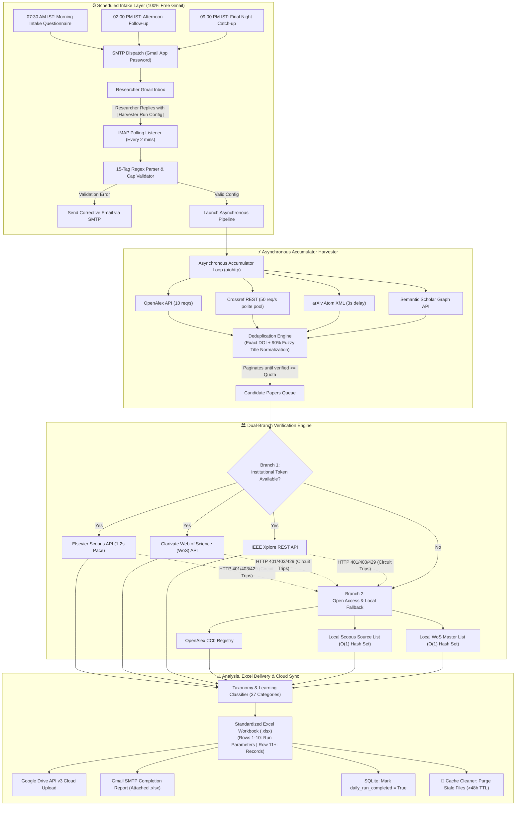

# 📘 Complete Handbook & Beginner's Guide

## Unified Academic Paper Harvester, Verifier & 100% Gmail-Driven Pipeline 🎓

Welcome to the definitive handbook for the **Unified Academic Paper Harvester & Verifier**. This guide provides an exhaustive, step-by-step walkthrough covering architecture diagrams, configuration, zero-cost Gmail automation, Google Drive synchronization, and execution routines.

---

## 📑 Table of Contents

1. [🏗️ System Architecture & Data Flow](#️-system-architecture--data-flow)
2. [✨ Core Objectives & Design Highlights](#-core-objectives--design-highlights)
3. [🐛 Root Bugs Resolved](#-root-bugs-resolved)
4. [🧹 Self-Cleaning Engine (48-Hour TTL Purge)](#-self-cleaning-engine-48-hour-ttl-purge)
5. [📋 Standardized Excel Database Schema](#-standardized-excel-database-schema)
6. [🚀 Complete Beginner's Walkthrough](#-complete-beginners-walkthrough)
   - [Step 1: Generating the Gmail 16-Character App Password](#step-1-generating-the-gmail-16-character-app-password)
   - [Step 2: Enabling IMAP in Gmail Settings](#step-2-enabling-imap-in-gmail-settings)
   - [Step 3: Setting Up Google Cloud Service Account & Drive API v3](#step-3-setting-up-google-cloud-service-account--drive-api-v3)
   - [Step 4: Configuring the `.env` File](#step-4-configuring-the-env-file)
   - [Step 5: Replying to the Intake Email Questionnaire](#step-5-replying-to-the-intake-email-questionnaire)
   - [Step 6: Testing & Launching the Pipeline Locally](#step-6-testing--launching-the-pipeline-locally)
7. [🛠️ CLI Reference & Usage Commands](#️-cli-reference--usage-commands)

---

## 🏗️ System Architecture & Data Flow

The engine operates on a three-tier lifecycle: Scheduled User Intake, High-Speed Literature Harvesting with Deduplication, Dual-Branch Index Verification, and Automated Excel & Cloud Dispatch.



---

## ✨ Core Objectives & Design Highlights

1. **100% Free Communication Layer:**
   - WhatsApp, Twilio, and Meta Cloud API have been completely eliminated.
   - All inbound queries, reminders, and outbound report deliveries run through your personal or university **Gmail account** at zero cost.
2. **Dual-Branch Index Verification:**
   - **Branch 1 (Institutional Token Mode):** Connects to Elsevier Scopus, Clarivate Web of Science Expanded, and IEEE Xplore APIs using academic subscription keys.
   - **Branch 2 (Open Access & Offline Hash Mode):** When working remotely or without paid tokens, queries OpenAlex and performs instantaneous $O(1)$ set matching against official offline Scopus (`data/scopus_source_list.xlsx`) and WoS (`data/wos_master_journal_list.csv`) ISSN registries.
   - **Circuit Breaker Protection:** If any commercial API returns HTTP `401`, `403`, or `429`, the circuit trips immediately to avoid hanging or burning rate limits, seamlessly redirecting the remaining records to Branch 2.
3. **Deterministic Batch Runner:**
   - Ingests multiple CSV files in `input/` strictly in alphabetical order.
   - Enforces strict error boundaries with `QUEUED`, `RUNNING`, `COMPLETED`, and `FAILED` SQLite state tracking.

---

## 🐛 Root Bugs Resolved

### Bug A: The "Sticking at 83 / 87" Pagination Freezing Bug

- **The Problem:** Public APIs (Crossref, Semantic Scholar, arXiv) silently issue HTTP 429 rate limit responses or return partial pages when paginating deeply. When paired with unlogged deduplication drops, older harvesting loops stalled permanently around record 83 or 87.
- **The Engineering Fix:**
  1. **Active Accumulator Loop:** The harvest loop evaluates `len(deduper.unique_papers) < target_quota` and continues paginating across active providers until the quota is satisfied or all remote records are genuinely exhausted.
  2. **Tenacity Exponential Backoff:** Every HTTP request inspects status codes and parses `Retry-After` response headers, backing off smoothly upon encountering HTTP 429.
  3. **Distinct Metrics Separation:** The pipeline logs three separate numbers:
     - `Raw Harvest Count` (total records downloaded from endpoints)
     - `Dropped Duplicate Count` (records discarded via exact DOI match or 90% title similarity)
     - `Final Verified Count` (records validated and retained)

### Bug B: The "3 out of 4 Files Processed" Bug

- **The Problem:** File ingestion loops in legacy batch runners lacked strict exception boundaries. An unhandled exception or parsing failure on one file caused the entire loop to terminate, dropping subsequent files silently.
- **The Engineering Fix:**
  1. Every single file ingestion is encapsulated within a strict `try/except/finally` block.
  2. Deterministic queue management using `pathlib.Path.glob("*.csv")` sorted alphabetically.
  3. Real-time task lifecycle tracking in SQLite (`data/pipeline.db`), recording `QUEUED`, `RUNNING`, `COMPLETED`, or `FAILED` for each file.

---

## 🧹 Self-Cleaning Engine (48-Hour TTL Purge)

To keep both local developer machines and headless cloud instances lightweight, `cache_cleaner.py` enforces an automated 48-hour time-to-live (172,800 seconds) lifecycle:

- **Monitored Directories:** `cache/`, `logs/`, and `temp/`.
- **Execution Routine:**
  1. Automatically runs every time `main.py` boots up.
  2. Runs before any scheduled intake reminder is dispatched.
  3. Runs immediately following every completed harvest or batch run.
- **Purge Criteria:** Unlinks any file where `(time.time() - os.path.getmtime(filepath)) > 172,800`.
- **Log Output:**
  ```text
  🧹 [CACHE CLEANER] Purged 4 stale cache files older than 48 hours.
  ```

---

## 📋 Standardized Excel Database Schema

Every generated workbook strictly maintains a 2-block layout:

- **Rows 1 to 10: Two-Column Metadata Block**
  - **Column A:** Metadata Labels (`Main Topic`, `Subtopics 1-5`, `Survey Questions 1-4`).
  - **Column B:** Metadata Values.
  - **Column C:** Empty separator column.
  - **Column D:** Run Configuration Labels (`Run Name`, `Run Type`, `Timestamp`, `Location`, `Batch Flag`, `Status`, `Target Quota`, `Retained Count`).
  - **Column E:** Run Configuration Values.

- **Row 11: Production Table Headers**
- **Row 12+: Verified Academic Paper Records**
  ```text
  Title | Authors | Publication Year | Journal/Source | DOI | URL | Scopus Indexed (Y/N) | WoS Indexed (Y/N) | IEEE Indexed (Y/N) | OpenAccess (Y/N) | Verification Source
  ```

---

## 🚀 Complete Beginner's Walkthrough

Follow these 6 steps to configure your environment from scratch.

### Step 1: Generating the Gmail 16-Character App Password

Gmail blocks plain account passwords in Python scripts for security. You must generate an **App Password**:

1. Open your browser and go to your [Google Account Security Settings](https://myaccount.google.com/security).
2. Under **"How you sign in to Google"**, ensure **2-Step Verification** is turned **ON**.
3. In the search bar at the top of the Google Account page, type **"App passwords"** and click on it.
4. In the "App name" box, type: `Academic Harvester`.
5. Click **Create**.
6. A yellow modal will display a **16-character code** (e.g., `abcd efgh ijkl mnop`).
7. Copy this password (without spaces: `abcdefghijklmnop`). This will be your `SMTP_PASSWORD` and `IMAP_PASSWORD`.

---

### Step 2: Enabling IMAP in Gmail Settings

The scheduler monitors your inbox for inbound questionnaire replies. IMAP must be active:

1. Open [Gmail](https://mail.google.com/) on your computer.
2. Click the **Gear icon (⚙️)** in the top right corner and click **"See all settings"**.
3. Click the **"Forwarding and POP/IMAP"** tab.
4. In the **"IMAP access"** section, select **"Enable IMAP"**.
5. Set **"When I mark a message in IMAP as deleted"** to **"Auto-Expunge on"**.
6. Set **"When a message is marked as deleted and expunged from the last visible IMAP folder"** to **"Archive the message"**.
7. Scroll to the bottom and click **Save Changes**.

---

### Step 3: Setting Up Google Cloud Service Account & Drive API v3

To automatically back up your output `.xlsx` files to a shared Google Drive folder:

1. Go to the [Google Cloud Console](https://console.cloud.google.com/).
2. Create a new project (e.g., `Paper-Harvester-Drive`).
3. In the left navigation menu, go to **APIs & Services > Library**.
4. Search for **Google Drive API** and click **Enable**.
5. Go to **APIs & Services > Credentials** and click **+ CREATE CREDENTIALS > Service account**.
6. Enter a name (e.g., `drive-uploader`) and click **Create and Continue**, then **Done**.
7. Under the **Service Accounts** list, click on your newly created service account email.
8. Go to the **KEYS** tab > click **ADD KEY > Create new key > JSON**.
9. A JSON file will download to your computer.
10. Rename that file to `service_account.json` and place it in the root of this project.
11. **Share your Google Drive folder:**
    - Open Google Drive and create a folder (e.g., `Academic Research Papers`).
    - Copy the folder ID from the URL (e.g., in `drive.google.com/drive/folders/1RAAhP5r2Ul0eNkDizDNfcIbB1azwwegT`, the ID is `1RAAhP5r2Ul0eNkDizDNfcIbB1azwwegT`).
    - Click **Share** on that folder, paste the **service account client email** (e.g., `drive-uploader@paper-harvester-drive.iam.gserviceaccount.com`), give it **Editor** permissions, and click **Share**.

---

### Step 4: Configuring the `.env` File

Copy `.env.example` to `.env`:

```powershell
cp .env.example .env
```

Open `.env` in any text editor and fill in your values:

```ini
# Polite Pool & Identity
POLITE_EMAIL=your_email@gmail.com
RESEARCHER_EMAIL=your_email@gmail.com
EMAIL_SENDER_NAME="Academic Paper Harvester Pipeline"

# Institutional Verification (Optional - Leave blank to use Branch 2 Open Access fallback)
ELSEVIER_API_KEY=
ELSEVIER_INST_TOKEN=
WOS_API_KEY=
IEEE_API_KEY=

# Gmail SMTP (Outbound Reports & Alerts)
SMTP_HOST=smtp.gmail.com
SMTP_PORT=587
SMTP_USER=your_email@gmail.com
SMTP_PASSWORD=your_16_char_app_password
SMTP_USE_TLS=true

# Gmail IMAP (Inbound Questionnaire Reader)
IMAP_HOST=imap.gmail.com
IMAP_PORT=993
IMAP_USER=your_email@gmail.com
IMAP_PASSWORD=your_16_char_app_password
IMAP_USE_SSL=true
IMAP_POLL_INTERVAL_SECONDS=120

# Google Drive Cloud Sync
GDRIVE_FOLDER_ID=SOme_URL_in_Gdrive
GDRIVE_SERVICE_ACCOUNT_JSON=service_account.json
```

---

### Step 5: Replying to the Intake Email Questionnaire

When the morning reminder arrives (or when testing), simply click **Reply** in Gmail and send your configuration tags in the body:

```text
[NAME_OF_RUN] Morning_Fuzzy_Run
[RUN_TYPE] Automated
[LOCATION] Home
[BATCH_RUN] No
[BATCH_DETAILS] None
[OUTPUT_MODE] Create New Excel
[TARGET_SHEET] Verified Papers
[TOPIC_COUNT] 1
[TOPIC_1] Fuzzy Logic and Deep Neural Networks
[TOPIC_2]
[TOPIC_3]
[TOPIC_4]
[TOPIC_5]
[T1_SUBTOPICS] Neuro-Fuzzy Systems, ANFIS, Explainable AI, Takagi-Sugeno
[T2_SUBTOPICS]
[T3_SUBTOPICS]
[T4_SUBTOPICS]
[T5_SUBTOPICS]
[PAPERS_PER_TOPIC] 250
[YEAR_RANGE] 2021-2026
[DOC_TYPE] Journal Articles
[INST_TOKEN] False
[TARGET_INDEX] Scopus, Web of Science, IEEE Xplore, Crossref, OpenAlex
[QUOTA_STRICTNESS] Strict
```

⚡ **Important:** Ensure the email subject contains `[Harvester Run Config]` (which happens automatically when you hit Reply). Within 2 minutes, the daemon reads your email, starts harvesting, and replies with your verified Excel report attached!

---

### Step 6: Testing & Launching the Pipeline Locally

1. **Verify Unit Tests:**

   ```powershell
   python main.py --test
   ```

   All tests should pass with `OK`.

2. **Run a Spontaneous Harvest:**

   ```powershell
   python main.py --query "neuro-fuzzy inference systems" --quota 100
   ```

3. **Process All CSVs in `input/` via Deterministic Batch Runner:**

   ```powershell
   python main.py --all
   ```

4. **Test Scheduled Reminders Immediately:**

   ```powershell
   python main.py --check-reminders --tier morning
   ```

5. **Start the Background Scheduler & IMAP Listener Daemon:**
   ```powershell
   python main.py --scheduler
   ```

---

## 🛠️ CLI Reference & Usage Commands

| Command                                                         | Action                                                        |
| --------------------------------------------------------------- | ------------------------------------------------------------- |
| `python main.py`                                                | Launches the interactive terminal control menu                |
| `python main.py --query "quantum machine learning" --quota 250` | Scrapes, verifies, and exports a single topic                 |
| `python main.py --all` (or `--batch`)                           | Runs deterministic batch processing on all CSVs in `input/`   |
| `python main.py --scheduler`                                    | Boots the 3-tier IST reminder and 2-min IMAP listener daemon  |
| `python main.py --clean-cache`                                  | Manually purges stale cache and log files older than 48 hours |
| `python main.py --check-reminders --tier afternoon`             | Dispatches the afternoon reminder email immediately           |
| `python main.py --test`                                         | Executes the complete test suite                              |

---

_Created for autonomous academic literature harvesting, authoritative indexing verification, and effortless email-driven research workflows._
