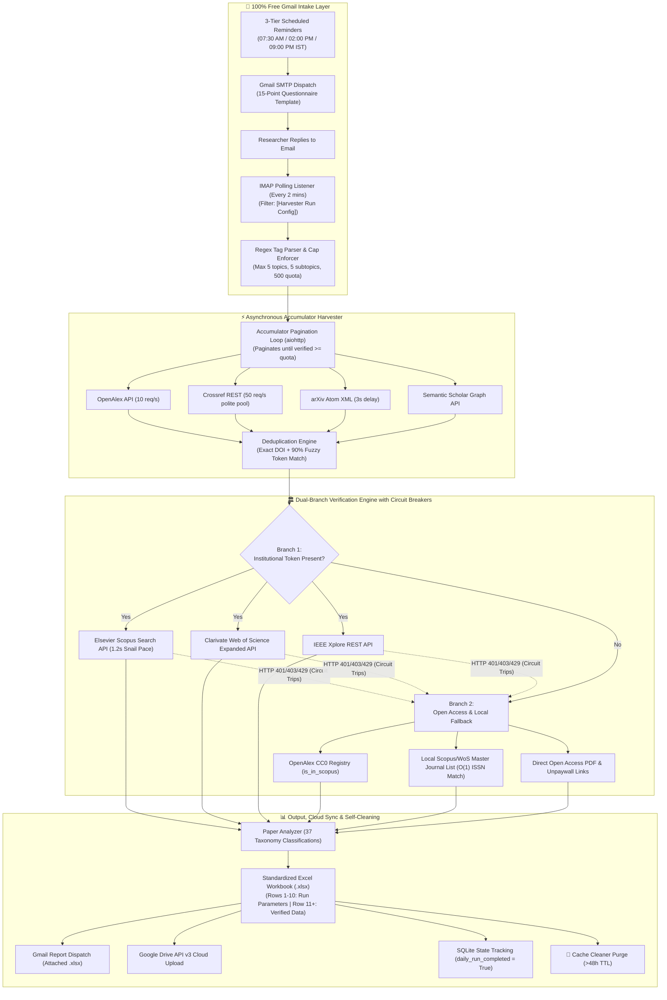

# 🎓 Unified Academic Paper Harvester, Verifier & 100% Gmail Pipeline

[](https://www.python.org/)
[](LICENSE)
[](tests/)
[](#1-system-architecture-overview)
[](#3-100-free-gmail-intake--scheduler)

A production-grade Python research automation engine combining high-speed multi-provider academic literature harvesting, dual-branch index verification (Elsevier Scopus, Clarivate Web of Science, IEEE Xplore, Crossref, OpenAlex), automated 48-hour cache life-cycle management, 100% free Gmail intake & reply parsing (SMTP/IMAP), and direct Google Drive v3 synchronization.

---

## 📑 Quick Navigation
* [🏗️ System Architecture Overview](#1-system-architecture-overview)
* [✨ Key Capabilities](#2-key-capabilities)
* [📧 100% Free Gmail Intake & Scheduler](#3-100-free-gmail-intake--scheduler)
* [🧹 Automated 48-Hour Cache Purging](#4-automated-48-hour-cache-purging)
* [🐛 Core Bugs Resolved](#5-core-bugs-resolved)
* [📊 Standardized Excel Database Format](#6-standardized-excel-database-format)
* [🚀 Quick Start & CLI Usage](#7-quick-start--cli-usage)
* [📘 Comprehensive Setup Handbook](HANDBOOK.md)

---

## 1. System Architecture Overview



---

## 2. Key Capabilities

* ⚡ **High-Speed Multi-Provider Harvesting:** Asynchronously harvests literature across OpenAlex, Crossref, arXiv, and Semantic Scholar using `aiohttp` with polite pool headers attached.
* 🏛️ **Dual-Branch Index Verification:** Authoritative subscription-based verification (Scopus, WoS, IEEE) seamlessly coupled with an Open Access offline fallback matching journal ISSNs against local databases.
* 🛡️ **Resilient Circuit Breakers:** Automatically catches HTTP 401, 403, and 429 status codes, tripping the affected provider and routing to fallback without crashing or stalling.
* 🧹 **Automated Cache Cleaner:** Unlinks and deletes cached JSONs, temporary query dumps, and logs older than 48 hours (172,800 seconds) on every boot, before intake, and after every completed run.
* 📁 **Deterministic Batch Execution:** Ingests all CSV files in `input/` deterministically sorted by filename using `pathlib.Path`, with `QUEUED`, `RUNNING`, `COMPLETED`, and `FAILED` SQLite states.
* ☁️ **Google Drive v3 Cloud Sync:** Directly uploads generated workbooks to designated Google Drive folders via service account credentials.

---

## 3. 100% Free Gmail Intake & Scheduler

All WhatsApp, Twilio, and Meta API code has been completely retired. The user interaction layer is powered 100% by Gmail:

1. **Three-Tier Reminders:**
   * **07:30 AM IST:** Dispatches the Morning Intake Questionnaire.
   * **02:00 PM IST:** Dispatches an Afternoon Catch-up Reminder if today's run has not been completed.
   * **09:00 PM IST:** Dispatches a Final Night Reminder for overnight scheduling.
   * **Midnight Reset:** Resets `daily_run_completed = False` at 00:00 IST for the new day.
2. **Inbound IMAP Poller:**
   * Polls unread emails every 2 minutes for subjects containing `[Harvester Run Config]`.
   * Extracts answers from the 15 configuration tags using regular expressions.
   * Enforces strict caps: maximum 5 topics, maximum 5 subtopics each, maximum 500 papers per topic.
   * If invalid, dispatches a corrective email explaining the issue. If valid, triggers the asynchronous pipeline immediately!

---

## 4. Automated 48-Hour Cache Purging

Local disk space and cloud runners are kept clean with `cache_cleaner.py`:
* **TTL:** 48 Hours ($172,800\text{ seconds}$).
* **Monitored Folders:** `cache/`, `logs/`, `temp/`.
* **Execution Points:**
  1. Bootup of `main.py`.
  2. Prior to dispatching any scheduled intake questionnaire.
  3. Immediately following any completed harvest or batch run.

---

## 5. Core Bugs Resolved

| Bug | Root Cause | Engineering Solution |
|---|---|---|
| **Sticking at 83 / 87 Items** | Unhandled HTTP 429 rate limits and unlogged deduplication truncation. | Implemented an active accumulator loop that paginates until `unique >= quota` combined with `tenacity` exponential backoff and `Retry-After` header parsing. |
| **3 out of 4 Files Processed** | Fragile file-matching without strict exception boundaries silently dropped tasks. | Wrapped all workers in strict `try/except/finally` blocks, enforced deterministic alphabetical sorting via `pathlib.Path`, and tracked `QUEUED`/`RUNNING`/`COMPLETED`/`FAILED` states in SQLite. |

---

## 6. Standardized Excel Database Format

Each generated `.xlsx` database strictly conforms to:
* **Rows 1 to 10:** Two-column run parameters header:
  - Columns A & B: Primary Metadata (`Main Topic`, `Subtopics 1-5`, `Survey Questions 1-4`).
  - Column C: Empty spacer column.
  - Columns D & E: Execution Metadata (`Run Name`, `Run Type`, `Timestamp`, `Location`, `Batch Info`, `Status`, `Target Quota`, `Retained Count`).
* **Row 11:** Production Table Headers.
* **Row 12+:** Verified Literature Records:
  ```text
  Title | Authors | Publication Year | Journal/Source | DOI | URL | Scopus Indexed (Y/N) | WoS Indexed (Y/N) | IEEE Indexed (Y/N) | OpenAccess (Y/N) | Verification Source
  ```

---

## 7. Quick Start & CLI Usage

### Installation
```powershell
pip install -r requirements.txt
cp .env.example .env
```

### Execution Commands
```powershell
# Interactive Terminal Menu
python main.py

# Spontaneous Harvest (Single Query)
python main.py --query "fuzzy rough sets" --quota 250

# Deterministic Batch Processing on all CSVs in input/
python main.py --all

# Launch 3-Tier IST Scheduler & IMAP Listener Daemon
python main.py --scheduler

# Check and Dispatch Pending Reminders Immediately
python main.py --check-reminders --tier morning

# Run 48-Hour Cache Purge Manually
python main.py --clean-cache

# Run Complete Automated Test Suite (23 Tests)
python main.py --test
```

---
*For in-depth step-by-step setup of Gmail App Passwords, IMAP settings, and Google Drive Service Accounts, read the [HANDBOOK.md](HANDBOOK.md).*
